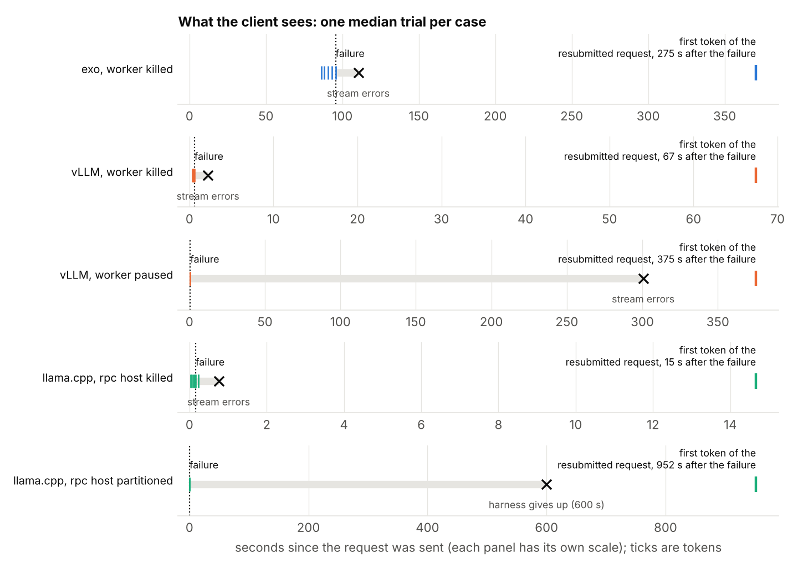
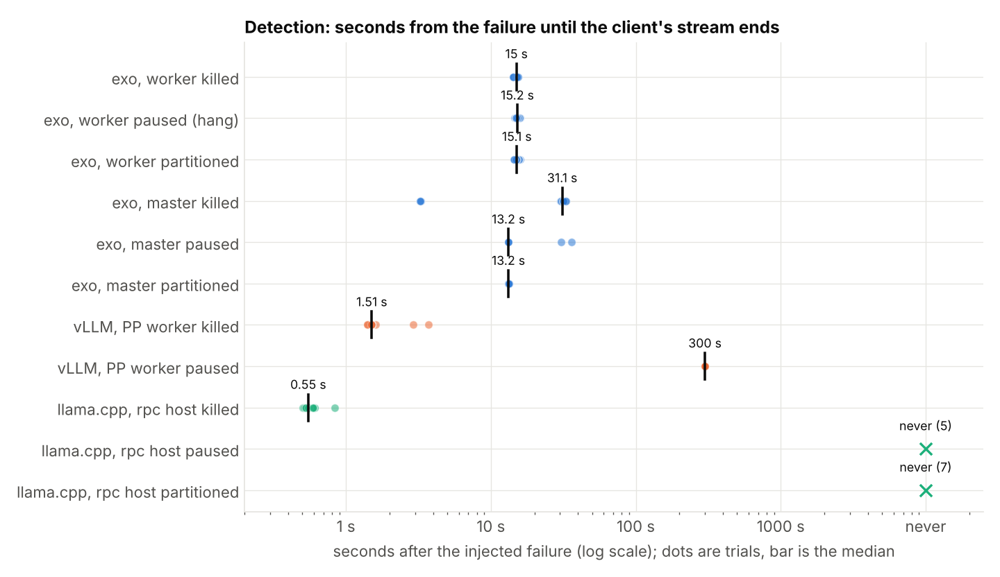
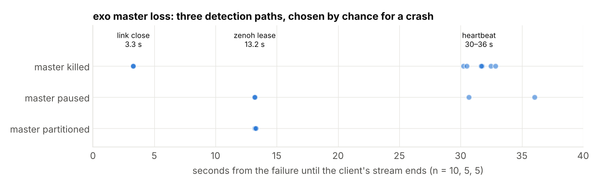
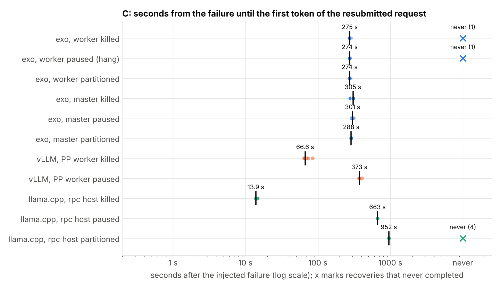
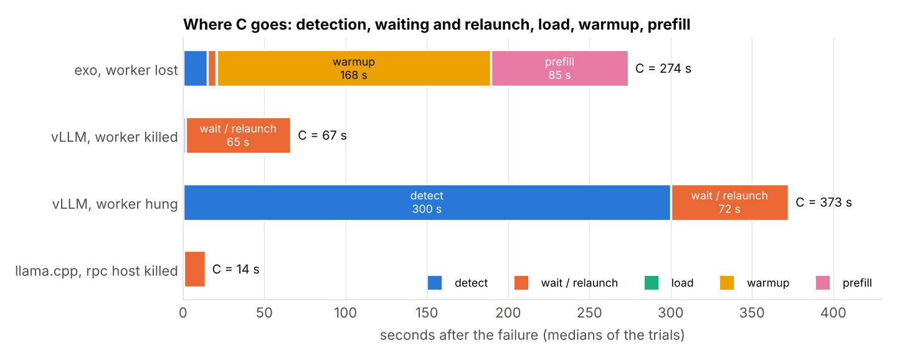
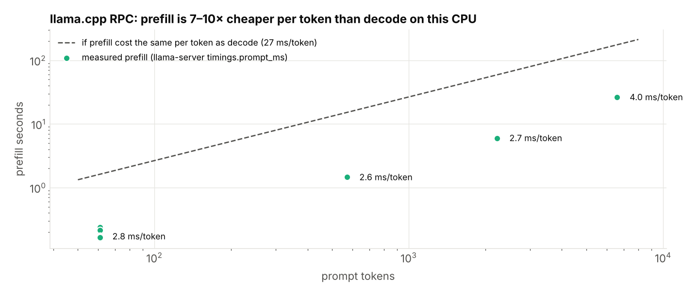
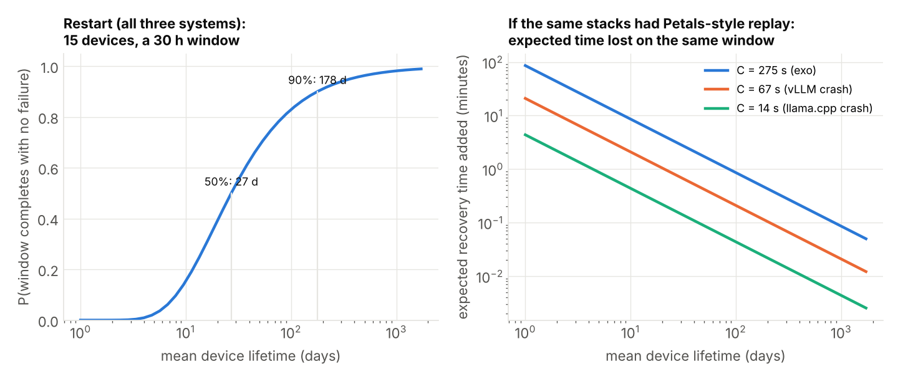

# distributed-inference-recovery

This is the third experiment in a series I began on the detection, containment and
removal of a hypothetical AI swarm that is no longer under human control. The first
experiment reproduced the failure curve of Petals ([Borzunov et al., *Distributed Inference
and Fine-tuning of Large Language Models Over The Internet*, NeurIPS 2023](https://arxiv.org/abs/2312.08361))
and reduced recovery to a single constant C; the second looked into what cuts a swarm.
Both ran on a model calibrated to the 2023 Petals paper, with the mechanism read from its
2024 code ([distributed-inference-resilience](https://github.com/thenaithan/distributed-inference-resilience)).
This third experiment measures that constant on three inference engines that are in use
today and can run one model across several machines. It is written for two readers: the
operator, who tries to keep the swarm serving under churn, and the defender, who needs the
smallest intervention that stops a swarm they do not operate.

I chose three systems: exo, vLLM and llama.cpp. exo is the consumer-device swarm that
[the essay's](https://naithanweigh.com/writing/asymmetric-persistence/) scenario assumes;
vLLM is the datacentre baseline, which I run in pipeline-parallel mode on CPU; llama.cpp's
RPC backend is the stack most likely to be found on real consumer hardware. Petals was the
only stack with in-request recovery, but its
[public repository](https://github.com/bigscience-workshop/petals) has had no commits since
September 2024.

The question is what happens when one node fails: how long until the request is served
again, and whether anything of the interrupted request survives. The reason for a third
experiment came halfway through the first, when I found the Frontier Red Team article
([Zhou and Freeman, *AI models may be capable of self-replicating without access to a
datacenter*, 2026-10-12](https://www.anthropic.com/research/self-replicating-ai)). It
chooses pipeline parallelism for fault tolerance, assumes a downed device is replaced and
its state recomputed, and prices neither. This experiment supplies the cost. I read each
failure path in source and wrote the predictions first, then injected the failure and
timed it: 107 trials over 11 cases, one at a time, on one CPU host.

The scope is to measure and model. None of the three systems re-places a lost node on its
own, and this experiment does not build that for them; it measures what they do as
shipped. I ran the trials; the source reading, harnesses, analysis and figures I developed
together with Claude, acknowledged at the end. Every number in this document comes from
the committed trial records (`trials.jsonl` in [`exo/`](exo/), [`vllm/`](vllm/) and
[`llamacpp/`](llamacpp/)) by way of [`analyze.py`](analyze.py); the full tables are in
[RESULTS.md](RESULTS.md), the failure paths and constants as read from source, with file
and line, in [FINDINGS-source.md](FINDINGS-source.md), and the predictions written before
measuring in [STUDY.md](STUDY.md).

## 1. What was measured

Experiment 3 of the distributed-inference resilience work. The model in
[distributed-inference-resilience](https://github.com/thenaithan/distributed-inference-resilience)
fits one constant $C$ to the Petals paper: the time from a node failing until the request
is being served again. Here $C$ is measured, phase by phase, on three systems people run
today, on one CPU host (i5-14600K, 20 logical CPUs unpinned, rootless Podman, EndeavourOS):

| system | version | setup | model |
|---|---|---|---|
| **exo** (consumer-device swarm) | bc412e2 | 3 nodes, pipeline sharding, MLX CPU backend | `mlx-community/Qwen3-0.6B-8bit` |
| **vLLM** (datacenter serving) | 0.32.0 CPU wheel | one server, pipeline parallel PP=2 | `Qwen/Qwen3-0.6B` |
| **llama.cpp RPC** (the CPU stack most likely on real consumer devices) | 74bca39 | two `ggml-rpc-server` hosts holding one layer slice each, one `llama-server` main host with no layers | `ggml-org/Qwen3-0.6B-GGUF` Q8_0 |

Every trial sends one streaming request (33-token prompt, 61 after the chat template, 30
tokens requested) and injects a failure into one node after the fifth output token. Three
failure shapes: **crash** (SIGKILL the process or the container), **hang** (SIGSTOP: the
process is alive, its sockets open, nothing moves) and **partition** (`podman network
disconnect`, sockets left open). exo was additionally measured with the *master* node as
the victim. 107 trials: exo 53, vLLM 20, llama.cpp 34 (plus plumbing runs not counted).

Four phases are timed per trial, all in seconds after the injected failure:

- **detect**: the client's stream ends (an error chunk or EOF). Until then the client is
  waiting on a request that is already dead.
- **gone**: the system has acted on the failure (instance deleted, server exited, port closed).
- **recover**: a replacement is serving again (re-placement or relaunch complete).
- **C**: first token of the resubmitted request. This is the constant the model uses.

exo's runner status timeline splits *recover* further into load, warmup and prefill;
llama.cpp reports its own prefill time. The failure paths and constants behind every
number were read from source first ([FINDINGS-source.md](FINDINGS-source.md), with
file:line), and the expected numbers were written down before measuring
([STUDY.md](STUDY.md)); §8 scores them. Every figure and number is reproduced from the
committed trial records by `analyze.py` and `figures.py`; the full tables are in
[RESULTS.md](RESULTS.md).

## 2. The result that holds everywhere

**No system preserved anything of an interrupted request, in 107 of 107 trials.** Every
trial ended with an error on the stream, or with the harness giving up on a stream that
never ended, followed by a fresh request after recovery. All three systems are the
*restart* strategy of Experiment 1, the one that collapses once a generation expects about
one failure ($p \approx 1/(ST)$). And none of them re-places or relaunches anything by
itself: `join_rate` in the model is whatever an operator or an orchestrator supplies, and
for a swarm that nobody operates it is zero. Petals (2023) remains the only stack with
in-request recovery, and it is the one nobody runs.



The figure shows one median trial per case as the client experienced it: tokens arrive,
the failure is injected, a silence follows that ends either in an error or in the harness
giving up, and the resubmitted request's first token arrives $C$ seconds after the failure.
Each panel has its own time scale; the silence is 15 s on exo and 600 s (the harness's
patience, not a detection) on a partitioned llama.cpp host.

## 3. Detection: three different regimes



**exo, worker lost: one case, decided by the master's clock.** Kill, pause and cut on a
non-master node all ended the stream 14.3 to 16.0 s after the failure (n = 33, median 15.0 s).
The mechanism is the same every time: the master's `NODE_SILENCE_TIMEOUT` (15 s) expires, it
emits `InstanceDeleted`, and the API turns that into an error chunk. Two detectors predicted
from source never fired. The ring-error path (the surviving rank's send fails and the
supervisor notices at its 5 s poll, predicted 1 to 6 s for a kill) did not appear in any
trial: a killed container's packets are dropped rather than reset, so the survivor's send
blocks instead of failing. The 90 s runner stall detector (predicted for a hang) is never
reached because the 15 s clock always fires first. The shape of the failure is irrelevant
to exo; detection is a single timer and it is the master's.

**exo, master lost: one of three paths, chosen by chance for a crash.**



| path | detect | mechanism | kill | pause | cut |
|---|---|---|---|---|---|
| link close | 3.3 s | the dying container closes TCP; zenoh's liveliness token is deleted within 0.1 s, an election follows 0.2 s later, one 3 s round | 3 | 0 | 0 |
| zenoh lease | 13.2 s | no close reaches the peers; zenoh's default 10 s link lease expires, then the election | 0 | 3 | 5 |
| heartbeat | 30 to 36 s | `MASTER_SILENCE_TIMEOUT` (30 s), then the election | 7 | 2 | 0 |

In every master-loss trial the request died although no shard had been lost: a master
change drops all generation tasks. That is a coordination failure stopping intact
computation, the Experiment 2 finding in miniature. `gone` follows at detect + 15 s,
because the new master runs its own silence clock on the dead node before deleting the
instance.

**vLLM: a factor of 200 from one constant.** A killed PP worker is detected in 1.5 s
(0.0 to 3.7, n = 10). The process sentinel fires within the second; the executor then waits
for the surviving rank to come out of its blocked send to the dead peer, 0 s if it was
between steps and up to 3.7 s if mid-send. A hung worker is detected in 300.0 s
(300.0 to 300.1, n = 10), which is `VLLM_EXECUTE_MODEL_TIMEOUT_SECONDS` to the decimal.

**llama.cpp RPC: sub-second on a reset, never otherwise.** When the rpc host's TCP
connection is closed by the kernel (the process killed, or the container killed: `podman
kill` terminates the process before its namespace goes, so the kernel still sends the
close), the main host's `recv` fails and llama.cpp does exactly what its source says:
`GGML_ABORT`, the whole `llama-server` gone within a second (detect 0.5 s, n = 15). A hang
or a partition is never detected: nothing in llama.cpp's RPC transport has a timeout or a
keepalive, so the main host blocks in `recv` indefinitely and the client sees a stream that
never ends. The harness gave up at 600 s in all 12 such trials.

| detect | crash | hang | partition |
|---|---|---|---|
| Petals (from source) | one hop | 180 s | 180 s |
| exo, worker | 15 s | 15 s | 15 s |
| exo, master | 3.3 or 30 s | 13.2 or 30 s | 13.2 s |
| vLLM | 1.5 s | 300 s | not measured |
| llama.cpp RPC | 0.5 s | never | never |

The prediction that detection is bimodal (fast on a crash, slow on a hang) held for vLLM,
did not hold for exo's workers, and held only partially for exo's master, where the fast
path is taken by chance.

## 4. Recovery cost



| | exo, worker lost | exo, master lost | vLLM, worker killed | vLLM, worker hung | llama.cpp, rpc host killed | llama.cpp, rpc host hung or cut |
|---|---|---|---|---|---|---|
| detect | 15.0 s | 3.3 / 13.2 / ~31 s | 1.5 s | 300.0 s | 0.5 s | never |
| gone | 15.0 s | 28 or 46 s | 4.5 s | 305 s | 0.7 s | never |
| recover | 174 s (load 0.6, warmup 168) | 174 s | 62 s | 75 s | 13 s | 2 s if the remote host lets go |
| prefill (33-token prompt) | 85 s | 85 s | 0.3 s | 0.3 s | 0.2 s | 0.2 s |
| **C** | **275 s** (272–282) | **305 s** kill, 301 pause, 288 cut | **66.6 s** (64–85) | **373 s** (369–403) | **14 s** (13.8–14.9) | pause: 600 s of harness patience + 3 s; cut: **952 s** when it recovers at all |
| recoveries that never complete | 2 of 53 | | 0 | 0 | 0 | cut: 4 of 7 without an operator |
| steady decode | 2.40 s/token | | 0.06 s/token | | 0.026 s/token | |



**exo: 92% of C is warmup plus prefill, 5% is detection.** Re-placement is accepted on the
first try (`replace_wait` 0.0 s in all 46 recoveries: by the time the instance is deleted
the dead node is already out of the topology). Load is 0.5 to 0.9 s (weights on disk).
Warmup is 168 s: exo decodes 50 tokens before `RunnerReady`, at 3.4 s/token. Prefill of the
33-token prompt is 85 s, 2.6 s/token, the same per-token cost as decode, because MLX's CPU
backend does not amortise weight reads over a batch. In tokens: 50 decode tokens of warmup
plus the prompt's prefill, whatever the hardware. Master loss costs the same recovery plus
the longer detection: 277 to 310 s.

**exo has a tail no median shows.** Two of 53 trials wedged on re-placement, both runners
stuck at `RunnerIdle` with no timeout in exo (`initialize_timeout` is dead code), the
cluster recreated by hand. With the two wedges seen in plumbing runs that is 4 in about 110
placements: a 2 to 4% mass at infinity, filed as
[exo#2464](https://github.com/exo-explore/exo/issues/2464).

**vLLM: C is relaunch.** 62 s after a kill (59 to 75) and 75 s after a hang (63 to 96); the
warm-up compile runs on every start even with the torch-compile cache warm. Prefill is 0.3 s.
C after a kill is 66.6 s, 93% relaunch; after a hang 373 s, 80% the 300 s timeout. In 4 of
the 10 hang trials the API server process outlived its closed port by more than 400 s, a
vLLM shutdown quirk (`kill_process_tree` enumerating children after the engine core has
already exited) that the harness waited on; those records carry C of 775 to 785 s and are
excluded as measurement artefacts. The six clean trials give the 373 s.

**llama.cpp: 14 s on a reset, and whether a partition ever heals is a coin flip.** After a
reset, recovery is the operator's: recreate the containers (13 s, 2 s of which is the server
coming up) and resubmit. After a pause, resuming the host and restarting the main host is
enough (2 s). After a partition, healing the network is not: the rpc server serves one client
at a time and is still inside `rpc_serve_client` on the vanished main host's connection, so
a restarted main host connects and waits forever for its hello to be answered. The rpc host
frees itself in exactly one case: if it was mid-send when cut, the kernel's retransmissions
run out (`tcp_retries2` = 15, documented lower bound 924.6 s) and the send fails. Three
trials recovered at 950, 952 and 954 s after the cut, the rpc host's own log dating the
close to the second; two hung for 1500 s and two more were recreated by the harness after
a 600 s restart window. Whether a healed partition heals llama.cpp RPC is decided by the
pipeline phase at the instant of the cut, and when it does, it takes fifteen minutes.

## 5. Prefill as a function of prompt length



Measured on llama.cpp by killing an rpc host and resubmitting prompts of 61, 571, 2221 and
6601 tokens (prefill as reported by `llama-server` on the fresh main host; the first stream
of a trial hits the prompt cache left by the previous trial and is not used):

| prompt tokens | prefill | per token | C |
|---|---|---|---|
| 61 | 0.2 s | 2.8 ms | 14.2 s |
| 571 | 1.5 s | 2.6 ms | 15.6 s |
| 2221 | 6.0 s | 2.7 ms | 19.9 s |
| 6601 | 26.5 s | 4.0 ms | 40.4 s |

Decode is 26 ms per token, so the prefill/decode ratio on this CPU is 7 to 10 with a batched,
optimised backend. exo's MLX backend gave about 1 (prefill as slow per token as decode); the
Frontier Red Team article's derived figures imply about 15. The regime conversion in §7 can
rest on a measured constant between the two.

## 6. What the measurements mean for the model

The resilience model's parameters, as measured (`analyze.py` prints them):

| parameter | exo (worker) | vLLM (kill) | vLLM (hang) | llama.cpp (kill) | llama.cpp (hang, cut) |
|---|---|---|---|---|---|
| `detect_time` | 15.0 s | 1.5 s | 300 s | 0.5 s | ∞ (client timeout) |
| `reconnect_time` (C minus prefill) | 190 s on this CPU (50 warmup tokens + 15 s + load) | 66 s | 373 s | 14 s | ∞, or ~950 s with probability ~½ after a partition |
| recovery never completes | 2–4% | 0 | 0 | 0 | cut: ~½ without an operator |
| strategy | restart | restart | restart | restart | restart, by hand |

Three consequences follow from the closed forms of the public model (`python -m
churnsim.measured` in that repo evaluates them):



1. **The cascade threshold is moot.** $\lambda^* = 1/(SC)$ is where replay recovery starts
   to lose ground to churn. None of the three has replay, so there is nothing to cascade;
   each failure simply costs the whole request. If they adopted Petals' mechanism with
   their measured $C$, the thresholds would be mean node lifetimes of 14 minutes (exo), 2 to
   12 minutes (vLLM) and 30 seconds (llama.cpp on a crash), and there is no threshold at all
   under a llama.cpp hang, because $C$ is unbounded.
2. **Under restart, the governing quantity is $e^{-N\lambda D}$,** the probability that a
   request of duration $D$ over $N$ nodes sees no failure at all. For the article's regime,
   15 devices and a 30 h window, completing 90% of the time needs a mean device lifetime of
   178 days; 50% needs 27 days. At a 7-day lifetime the window completes 7% of the time,
   with an expected wall time of 437 h; at 1 day it never does.
3. **The recovery mechanism is the whole difference.** With replay recovery the same window
   at a 7-day lifetime costs 2.7 expected failures and 12 minutes of recovery at exo's $C$,
   or 36 seconds at llama.cpp's. Between "never finishes" and "loses twelve minutes" sits
   one mechanism, and no current stack ships it.

## 7. Connection to the Frontier Red Team article

The article (Zhou and Freeman, *AI models may be capable of self-replicating without access
to a datacenter*, 2026-10-12) chooses pipeline parallelism for its fault tolerance, citing
Borzunov et al. 2022, and assumes a downed device is replaced and its KV state recomputed;
it prices neither the replacement nor the churn. Measured against the stacks that exist:
none replaces anything, and the recompute it assumes is a prefill. Restated in the article's
own regime (`analyze.py --regime tvbox-26b`: the measured timers kept, warmup and prefill
converted with the article's derived per-token speeds; an assumption, not a measurement),
the exo trial is 13 to 18 minutes for a 33-token prompt and a 28k-token prefill alone is
7.8 to 10.5 hours of a 27 to 32 h window. The article's defence framing, driving $R_0$ below
1 by quarantine, is churn imposed by a defender; $e^{-N\lambda D}$ with a measured $C$ is
the number that framing needs.

## 8. Predictions against measurements

Written in STUDY.md before any trial ran; the full table is RESULTS.md §8.

| prediction | measured | verdict |
|---|---|---|
| exo worker kill detect 1–6 s (ring error) | 15 s | wrong: the ring error never surfaces; the master's clock decides |
| exo worker pause detect 90 s, or ~15 s if the master's deletion wins | 15 s | the second branch |
| exo recover 150–200 s, load ~1 s, warmup ~150 s; C 250–300 s | 174 s, 0.6 s, 168 s; 275 s | right |
| exo master: zenoh expiry ~10 s + 3 s election, or 30 s | 3.3 / 13.2 / 30 s by path | right, with a third path |
| placement refusal adds up to 15 s | 0 s | wrong: the node is already dropped when deletion fires |
| vLLM kill detect < 1 s; relaunch 20–60 s; pause detect 300 s | 1.5 s; 62 s; 300.0 s | nearly; slightly over; right |
| llama.cpp killproc detect well under 1 s, relaunch seconds | 0.6 s, 13 s | right |
| llama.cpp kill (container torn down) never detected | 0.5 s | wrong: `podman kill` lets the kernel close the connection |
| llama.cpp pause and cut never detected; recovery manual | never; manual, plus `tcp_retries2` after a cut | right, with a mechanism |

## 9. Side findings

- exo's SSE keep-alives make client-side socket timeouts useless: the connection stays
  busy while the request is dead. Detection is token-based and equals whatever the server's
  own detector takes.
- exo's `mlx-cpu` extra pairs a fork binding with a mismatched CPU library
  ([exo#2359](https://github.com/exo-explore/exo/issues/2359)); the placement deadlock
  ([exo#2464](https://github.com/exo-explore/exo/issues/2464)) sits between the GIL and a
  multiprocessing queue.
- vLLM's CPU install needed four fixes (documented in `vllm/trial.py`); `kill_process_tree`
  can leave the API server alive after the engine has exited.
- llama.cpp's RPC README says never to run the backend on an open network. The measurement
  says why: a peer that stops answering is never noticed, and a healed partition heals the
  pipeline only by the kernel giving up on retransmission.

## 10. Limitations

One CPU host, unpinned, with a near-ideal virtual network; one request at a time; the
failure injected at a fixed token; small models. exo's image deviates from stock (the
official mlx binding instead of the broken `mlx-cpu` pairing, tmpfs `/tmp` for MLX's JIT
cache). vLLM's partition case was not measured, nor disaggregated prefill/decode, nor any
system with in-request recovery. n is 10 to 12 per (system, mode) for the main cases and 5
for the rest. Regime conversions in §7 are assumptions from the article's own figures.
$C$ as a function of prompt length was measured on llama.cpp only.

## Conclusion

<!-- CONCLUSION (Nat) -->

## Repository

- `FINDINGS-source.md`: what exo, vLLM and llama.cpp RPC do on node loss, read from source
  with file:line, and what it means for the model before any measurement.
- `STUDY.md`: framing, predictions written before measuring, reading list.
- `RESULTS.md`: the full measured tables for all three systems.
- `analyze.py`: trial records → detect / gone / recover / C, the model parameters, and the
  `--regime` restatement. `figures.py`: the figures above, from the same records.
- `exo/`, `vllm/`, `llamacpp/`: `Containerfile`, `cluster.sh`, `trial.py`, `run_trials.sh`
  and the raw trial records (`trials.jsonl`) per system.

### Reproducing

CPU pinning is off by default: exo's nodes float over all host CPUs and vLLM uses its own
`auto` thread binding. To give each node or PP rank its own cores, set `EXO_CPUSETS` (exo,
one set per node, e.g. `"0-3 4-7 8-11"`; needs the `cpuset` cgroup controller delegated to
your user, `cluster.sh up` prints how) and `VLLM_CPU_OMP_THREADS_BIND` (vLLM, e.g.
`"0-3|4-7"`). Each trial records the CPU sets or binding it ran with. The llama.cpp harness
has no pinning; each host runs `LLAMA_THREADS` threads (default 4).

exo (needs Podman with IPv6 networking; first build downloads the model per node):

```
podman build -t exo-node -f exo/Containerfile exo
exo/cluster.sh up 3
python3 exo/trial.py --nodes 3 --mode none                     # plumbing check
python3 exo/trial.py --nodes 3 --fail-worker --mode kill  --out exo/trials.jsonl   # a non-master node; injects after 5 tokens, 30 requested
exo/cluster.sh down && exo/cluster.sh up 3                      # fresh cluster between trials (restores the failed node)
python3 exo/trial.py --nodes 3 --fail-worker --mode pause --out exo/trials.jsonl
python3 exo/trial.py --nodes 3 --fail-master --mode kill --out exo/trials.jsonl       # master loss: kills whichever node is master, streams via a survivor
nohup exo/run_trials.sh cut worker 10 > exo/logs/run_trials.out 2>&1 &            # unattended: recreate cluster + trial until 10 complete cut-worker results
python3 analyze.py exo/trials.jsonl --regime tvbox-26b
```

vLLM (CPU backend; install steps in the `vllm/trial.py` docstring; the harness sets the
OpenMP binding, preload and triton backend itself):

```
source .venv/bin/activate
python3 vllm/trial.py --mode none
python3 vllm/trial.py --mode kill  --at-token 5 --out vllm/trials.jsonl
python3 vllm/trial.py --mode pause --at-token 5 --out vllm/trials.jsonl
for i in $(seq 10); do python3 vllm/trial.py --mode kill --at-token 5 --out vllm/trials.jsonl; done   # each trial launches and stops its own server
python3 analyze.py vllm/trials.jsonl
```

llama.cpp (rootless Podman; first start downloads `ggml-org/Qwen3-0.6B-GGUF` into the
`llama-models` volume):

```
podman build -t llamacpp-rpc -f llamacpp/Containerfile llamacpp
llamacpp/cluster.sh up 2
python3 llamacpp/trial.py --mode none --out llamacpp/smoke.jsonl                      # plumbing: usage.prompt_tokens and timings.prompt_ms present?
python3 llamacpp/trial.py --mode killproc --out llamacpp/trials.jsonl                 # reset: expect sub-second detect, then relaunch
python3 llamacpp/trial.py --mode kill     --out llamacpp/trials.jsonl                 # container killed: the same reset as killproc (§3)
python3 llamacpp/trial.py --mode pause    --out llamacpp/trials.jsonl                 # hang: never detected; the harness gives up at 600 s
nohup llamacpp/run_trials.sh all > llamacpp/logs/run_trials.out 2>&1 &              # unattended: 10 × killproc, 5 × kill/pause/cut, killproc at 512/2048/6144 prompt tokens ×2 (~4 h)
python3 analyze.py llamacpp/trials.jsonl
```

Figures: `python3 figures.py` (matplotlib) rewrites `figures/`.

### Status

- [x] failure paths and constants read from source (exo bc412e2, vLLM 8407bc0, llama.cpp 74bca39)
- [x] harnesses written; exo plumbing check (2026-10-21) with image fixes for exo's mlx-cpu pairing and MLX's JIT path; vLLM plumbing check (2026-10-23), CPU install needed four fixes
- [x] reported upstream: exo placement deadlock [exo#2464](https://github.com/exo-explore/exo/issues/2464), mlx-cpu pairing in [exo#2359](https://github.com/exo-explore/exo/issues/2359)
- [x] trials: exo 2026-10-21..23 (kill/pause/cut worker ×10–12, kill master ×10, pause/cut master ×5); vLLM 2026-10-24/25 (kill, pause ×10); llama.cpp 2026-10-25/26 (killproc ×10, kill/pause/cut ×5, prefill sweep ×2 per length)
- [x] all three systems analysed and written up
- [x] measured $C$ into the resilience model (`churnsim.measured`, NOTES §6 and the applicability section of the public repo)

## Acknowledgement

The source reading, harnesses, analysis and figures were developed together with Claude
(Anthropic). The trials were run, and the write-up is, by Naithan Weigh.
